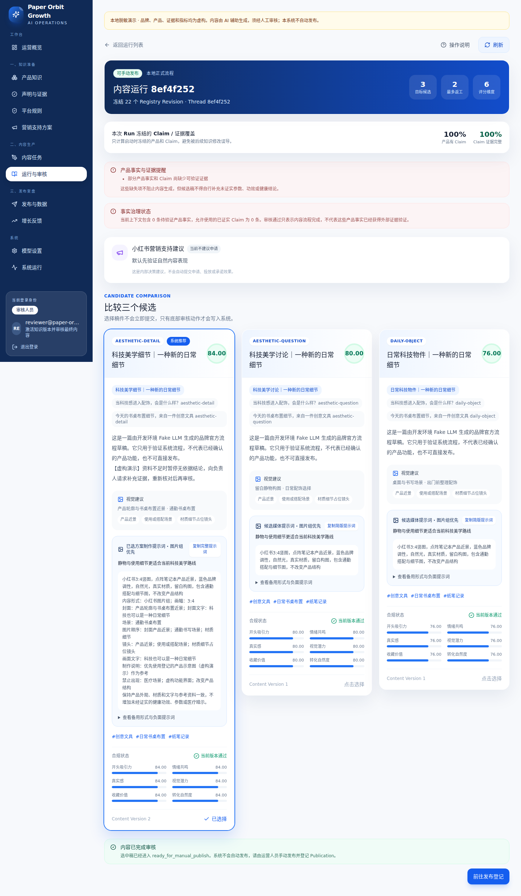

# Paper Orbit · 内容审核 Agent 工作台

用虚构文具资料演示“资料导入 → 版本与证据治理 → 三稿生成 → 合规和评分 → 返工与审核 → 本地模拟发布登记 → 反馈”。保留原应用的 FastAPI、Registry、角色权限、PostgreSQL Worker 和 LangGraph 中断恢复，默认无需模型密钥。

适合展示 Agent 的业务契约、来源与证据约束、受控返工、持久任务及人机协作。离线输出是确定性 fixture，不是模型质量测试；页面“发布”只登记本地记录，不向平台发帖。继承与后续改造见 [NOTICE](NOTICE.md)，代码使用 [MIT](LICENSE)。

本轮独立候选已完成零模型验收，精确结果见 [验证摘要](release/validation-20261018.json)。下面截图来自虚构资料与自动化角色审核，不是模型效果或真人批准证据。



## 1. 环境与安装

支持 Linux/WSL2；使用 Python 3.12、uv、Node 24/npm、Docker Engine。首次安装依赖和数据库镜像需要网络；运行演示不请求模型供应商。解压发布候选后进入包含本 README 的目录；不要使用作者的旧 `.runtime`、虚拟环境或数据库。

```bash
uv sync --locked --extra dev
npm ci --prefix frontend --ignore-scripts
npm run build --prefix frontend
```

仅后端流程排练无需 Docker 和前端：

```bash
uv run --locked --extra dev python scripts/offline_demo.py \
  --output .runtime/rehearsal-001/report.json
```

使用临时 SQLite 和内存检查点，验证冲突、去重、证据门禁、版本冻结、违规拒绝与返工。它不是 PostgreSQL 重启恢复验证。输出目录必须全新，重跑请换 `rehearsal-002`；失败记录不要删除或改成通过。

## 2. 启动完整工作台

下方使用实例 `demo`，Web 端口 **8766**、数据库端口 **55433**。先确认 Docker 正常且端口空闲：

```bash
uv run --locked --extra dev python scripts/local_runtime.py setup --instance demo
uv run --locked --extra dev python scripts/local_runtime.py serve --instance demo
```

另一个终端在同一项目目录启动 Worker：

```bash
uv run --locked --extra dev python scripts/local_runtime.py worker --instance demo
```

看到 Uvicorn 启动后打开 http://localhost:8766/login 。选择“以编辑进入演示”处理内容，选择“以审核员进入演示”审核；管理员可查看管理页面。这是本机角色切换，不是企业认证，也不是实际三人协同。

服务与 Worker 终端需保持打开；Ctrl+C 停止。重新运行相同命令可恢复原实例。不要清空数据库或删除配置来解决启动失败。

### 实例与数据隔离

- 容器、Volume 和私有配置按“当前目录摘要 + 实例名”隔离；不会使用旧 `paper-orbit-db`。
- 运行状态在 `.runtime/instances/demo/`；数据库 Volume 是持久数据。
- 随机数据库口令、JWT 和本机初始化口令只写入仓库外 `~/.local/share/paper-orbit/<命名空间>/`，目录700、文件600。此目录需要与数据库一起保留和备份；丢失时应恢复，不能为原 Volume 自动生成新口令。
- 查看非敏感配置：`uv run --locked --extra dev python scripts/local_runtime.py info --instance demo`。
- 新练习用新实例。并行启动时还需新端口，例如所有 setup/serve/worker 命令统一追加 `--instance practice2 --port 8767 --db-port 55434`。同一实例不能随意更换端口。
- 秘密配置不要写入仓库、`.env`、报告或截图。推荐启动器忽略环境中的供应商设置、不读取供应商凭据文件，并拒绝外部 HTTP；只提供 fake 模式。

## 3. 先跑正常流程，再演示返工

### 编辑：创建任务

1. 用“以编辑进入演示”登录，打开“内容 Brief”。首次 setup 已准备虚构产品、证据、规则、Prompt 和量表，不需要配置模型。
2. 点击“新建 Brief”。填写：任务名称“虚构文具审核演示”；内容目标“介绍纸笔记录场景，不承诺效率或健康效果”；希望用户记住“一款点阵布局笔记本”；核心场景“书桌记录待办”。
3. 支持方案策略选择“本次仅自然流量”；其余保留默认，点击“保存 Brief”→“立即启动任务”。
4. 运行详情从排队进入待人工审核，应出现三个候选、合规报告和评分。若一直排队，确认 Worker 使用同一个实例和端口。
5. 编辑只能查看，不能批准。内部评分不代表实际内容效果。

### 审核员：退回、检查新版、批准

1. 记录当前运行详情链接。在另一个浏览器隐私窗口打开登录页，选择“以审核员进入演示”，再打开该链接。
2. 选择一个没有 blocker 的候选，点击“要求修改”，填入下面的**固定离线示例**：

   **请补充虚构演示标识，并说明资料不足时需补充证据。**

3. 点击“提交修改要求”。Worker 恢复检查点，生成新 Content Version，重新合规与评分，再回到待审核。
4. 核对新正文出现“【虚构演示】资料不足时暂停无依据结论……”；旧版本和审核记录保留。再点击“批准选中稿”。
5. 等待状态为 `ready_for_manual_publish`，页面出现“内容已完成审核”。这表示本地内容流程完成，不是已经向外发布。

离线返工只为上面的精确示例提供确定性补充，不保证理解任意意见。其他需求请用“编辑后批准”人工改正文，再重新检查；必须自行确认改动，不能仅凭版本增加就认为意见已解决。违规稿不能因评分高而获批准。

### 编辑：模拟登记与反馈

1. 回到编辑窗口，打开“发布与数据”，点击“登记 Publication”，选择刚审核的版本。
2. 笔记 ID 填 `fictional-demo-001`，URL 填 `https://example.com/fictional-publication`，确认登记。**这是虚构本地记录，不要填写真实平台业务数据，也不需要点击外链。**
3. 找到该记录，点击“录入指标”，填写虚构累计值：阅读60、点赞4、收藏3、评论1，保存快照。
4. 打开“增长反馈”→“Feedback 分析”，勾选这条有指标的虚构笔记，点击“开始分析”。Worker 完成后可查看有边界的建议。
5. 策略建议先是草稿；审核激活是另一个决定。模拟指标和分析结果不能表述为真实增长、因果效果或真人审核。

## 4. 复杂资料：单独练习，保留旧版本

[demo/materials](demo/materials/) 包含 V1 规格、冲突供应商便笺、人工确认 V2、有限范围证据、无依据承诺及当前/历史虚构规则。

- 产品知识中导入 V1，再导入冲突便笺；冲突应待处理，不直接覆盖已激活资料。
- 重复导入同一材料应在模型步骤前去重；确认 V2 后创建新 Revision，由审核员激活。
- 在 Claim/证据中验证来源再激活允许的事实；没有证据的防水或效率承诺不能变成已证实效果。
- 旧 Run 使用冻结版本，新 Run 使用新的 active Revision。虚构规则不是实际平台政策。

若只想查看完整预制案例，在**新实例**执行 setup 后，先不启动 Worker，运行：

```bash
uv run --locked --extra dev python scripts/local_runtime.py demo-scenarios --instance practice2 --port 8767 --db-port 55434
```

这条命令直接调用原服务、图和脚本审核员安装固定案例；不代表你从页面手工完成。它保留一个故意不执行的历史快照比较任务，建议与第3节的交互练习使用不同实例。安装中断后保留现场，不自动覆盖或清空。

## 5. 验证与发布候选

```bash
uv run --locked --extra dev pytest -q
uv run --locked --extra dev ruff check smart_growth_agent tests scripts/local_runtime.py scripts/export_release.py scripts/audit_release.py scripts/offline_demo.py scripts/offline_e2e.py scripts/browser_acceptance.py
npm test --prefix frontend
npm run lint --prefix frontend
npm run build --prefix frontend
```

启动一个完成 setup 的新离线实例和 Web 服务，**不要另外启动常驻 Worker**，脚本会在各阶段启动新的 Worker 进程：

```bash
uv run --locked --extra dev python scripts/offline_e2e.py --instance demo --output .runtime/api-check-001/report.json
uv run --locked --extra dev playwright install chromium
uv run --locked --extra dev python scripts/browser_acceptance.py --instance demo --output .runtime/browser-check-001
```

端口自定义时两个脚本也必须传相同 `--port`、`--db-port`。API 脚本检查编辑越权拒绝、实质返工、新进程恢复、模拟登记与反馈；浏览器脚本通过页面新建 Brief/任务、角色切换、返工批准、登记指标和反馈。资料冲突与证据门禁另由离线排练覆盖。全部输出路径必须新建，历史 Run ID 不用于新验收。

本地候选导出和扫描，不会推送：

```bash
uv run --locked --extra dev python scripts/audit_release.py
uv run --locked --extra dev python scripts/export_release.py --output .runtime/export-001
```

发布范围由 [白名单](release/manifest.json) 确定；导出生成 SHA256 清单。排除数据库、秘密配置、原 Git 历史、账号状态、缓存、截图原日志和旧活动额度。完整历史报告留在原副本，本候选使用新验证记录；[当前验证说明](docs/RELEASE_VALIDATION.md)区分实测和未验证事项。

## 常见问题

| 现象 | 操作 |
|---|---|
| Docker 不可用、端口占用 | 启动 Docker 或为新实例统一选择新端口；不要删除旧 Volume |
| 实例配置不匹配 | 使用首次 setup 时的实例和端口；新练习换实例 |
| 旧数据库存在但缺少私有配置 | 恢复对应配置备份；不重新生成口令覆盖数据库 |
| 页面没有前端或显示旧代码 | 安装前端依赖并重新 build，重启同一实例服务 |
| Run 一直排队或审核后不继续 | 确认 Worker 正在运行且实例参数一致；验收脚本期间不要额外开 Worker |
| 显示 blocker 或任务失败 | 查看报告和原意见；保留失败记录，不直接改状态 |
| 修改后正文没变化 | 任意自然语言不属于离线 fixture 能力；使用固定例子或人工编辑后重检 |
| 关闭终端后服务停止 | 再次启动 serve 和 worker；本项目默认不是常驻服务 |

## 能力边界

本机演示角色、确定性 fake、SQLite 模块测试与单实例 PostgreSQL 验证，不是生产部署、真实政策合规、通用事实核验、广泛注入防护或模型质量基准。通用模型适配与预算代码保留，但本轮不授权真实调用；推荐启动器不提供 real 参数。HTTP 门禁是应用级约束，不是操作系统沙箱。旧来源文档是历史说明，以本 README 和本轮独立验证为准。
